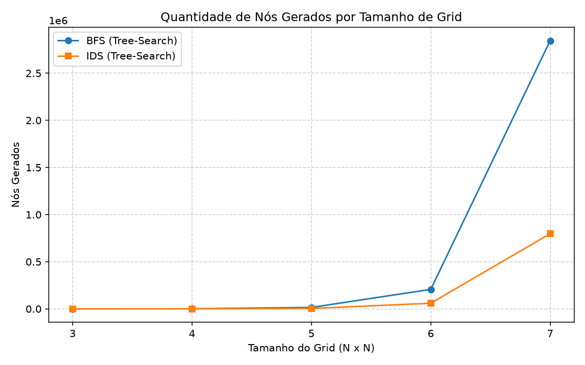
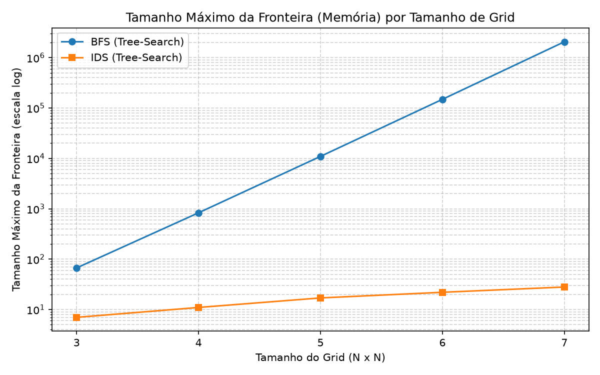
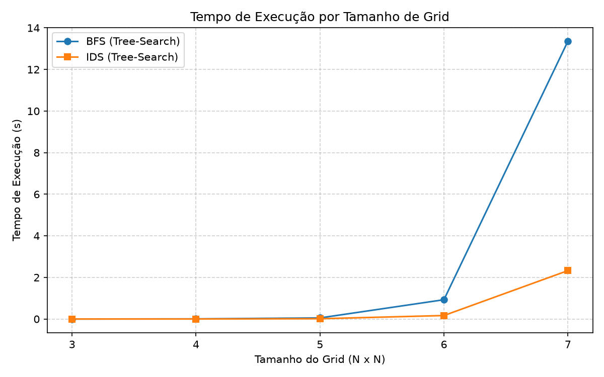

# Relatório de Experimento (Opção D.1): Comparação entre BFS e IDS em Árvore (Tree-Search)

**Equipe:**
* Ana Nínive Ribeiro de Oliveira
* Bruno Leonardo Assis Pimentel
* Everton Luan Gomes Batista
* Letícia Gomes da Silva

---

## 1. Pergunta de Pesquisa
> **"Qual o impacto no consumo de memória (tamanho máximo da fronteira), no número de estados gerados e no tempo de execução ao utilizar a Busca por Aprofundamento Iterativo (IDS) em comparação à Busca em Largura (BFS), ambas em versão Tree-Search, para encontrar caminhos ótimos em grids abertos de tamanhos crescentes?"**

Tanto a Busca em Largura (*Breadth-First Search* - BFS) quanto a Busca por Aprofundamento Iterativo (*Iterative Deepening Search* - IDS) são estratégias de busca cega completas e ótimas para problemas com custo de passo uniforme. Na teoria clássica de Inteligência Artificial, o IDS combina a otimalidade e completude do BFS com o baixo consumo espacial da Busca em Profundidade (DFS), ao custo de re-expandir nós de níveis superiores repetidas vezes. Este experimento investiga esse *trade-off* na prática utilizando a biblioteca `search_lib`.

---

## 2. Explicação dos Experimentos

### O Problema Utilizado
Utilizámos o problema de busca de caminhos em malha bidimensional (`GridPathfinding`), sem obstáculos e apenas com movimentos ortogonais (`permite_diag=False`), onde cada movimento possui custo uniforme igual a `1.0`.

### O que Varia e Quais as Entradas
1. **Variável Independente 1 (Estratégia de Busca):**
   - `BFSTree`: Busca em Largura em árvore (fila FIFO), sem verificação de estados repetidos.
   - `IDS`: Busca por Aprofundamento Iterativo em árvore, que invoca a Busca em Profundidade Limitada (`DLS`) iterativamente para limites $L = 0, 1, 2, \dots, d$, acumulando o total de nós gerados/expandidos e registando o pico máximo da fronteira.
2. **Variável Independente 2 (Tamanho do Problema $N \times N$):**
   - Variámos a dimensão do grid aberto em 5 níveis: **$3\times3$, $4\times4$, $5\times5$, $6\times6$ e $7\times7$**.
   - Para cada tamanho $N$, o estado inicial foi fixado no canto superior esquerdo `GridState(0, 0)` e o estado objetivo no canto inferior direito `GridState(N-1, N-1)`. Assim, a profundidade da solução ótima cresce linearmente conforme $d = 2(N - 1)$ (profundidades $4, 6, 8, 10$ e $12$, respetivamente).
   - Ambas as estratégias foram executadas exatamente sobre a mesma instância de problema e estado inicial em cada tamanho.

### Métricas Avaliadas
- **Quantidade de nós gerados (`nodes_generated`)**: Total de nós instanciados durante toda a busca (no IDS, soma todas as iterações de limite $0$ até $d$).
- **Tamanho máximo da fronteira (`max_frontier_size`)**: Mede a complexidade espacial na prática (pico de nós armazenados simultaneamente em memória).
- **Tempo de execução (`execution_time`)**: Tempo de relógio (em segundos) medido via `time.perf_counter()`.

---

## 3. Apresentação dos Resultados

### Tabela Comparativa de Desempenho

| Tamanho do Grid ($N \times N$) | Profundidade Ótima ($d$) | Algoritmo | Nós Expandidos | Nós Gerados | Tamanho Máx. da Fronteira | Tempo de Execução (s) |
| :---: | :---: | :---: | :---: | :---: | :---: | :---: |
| **3x3** | 4 | BFS | 80 | 209 | 130 | 0.00032 |
| **3x3** | 4 | IDS | 120 | 290 | **10** | 0.00018 |
| **4x4** | 6 | BFS | 964 | 2.757 | 1.794 | 0.00673 |
| **4x4** | 6 | IDS | 1.326 | 3.658 | **16** | 0.00119 |
| **5x5** | 8 | BFS | 10.674 | 31.953 | 21.280 | 0.05213 |
| **5x5** | 8 | IDS | 14.375 | 41.737 | **22** | 0.01383 |
| **6x6** | 10 | BFS | 114.616 | 352.717 | 238.102 | 0.92727 |
| **6x6** | 10 | IDS | 153.208 | 460.056 | **28** | 0.16696 |
| **7x7** | 12 | BFS | 1.213.524 | 3.802.001 | 2.588.478 | 13.35497 |
| **7x7** | 12 | IDS | 1.618.423 | 5.002.634 | **34** | 2.32652 |

*(Nota: Os valores exatos de tempo de relógio variam ligeiramente conforme a máquina onde o script `experiment.py` é executado, mantendo a mesma proporção).*

### Gráficos das Métricas

#### 1. Quantidade de Nós Gerados

#### 2. Tamanho Máximo da Fronteira (Consumo de Memória)

#### 3. Tempo de Execução

---

## 4. Conclusão

Os resultados experimentais comprovam com precisão a teoria clássica sobre buscas cegas em árvore:

1. **Economia Drástica de Memória (Complexidade de Espaço):** Como evidenciado pelo gráfico de tamanho máximo da fronteira (em escala logarítmica), a fronteira do **BFS** cresce exponencialmente ($\mathcal{O}(b^d)$), chegando a armazenar mais de **2,58 milhões de nós simultaneamente** na memória no grid $7\times7$. Em contrapartida, o **IDS** mantém uma fronteira estritamente linear ($\mathcal{O}(b \cdot d)$), precisando de armazenar no máximo **34 nós** no mesmo grid $7\times7$. Em problemas maiores (como $8\times8$ ou $9\times9$), o BFS em árvore rapidamente esgota a memória RAM da máquina (`MemoryError`), enquanto o IDS continua a operar com consumo de memória desprezível.
2. **Sobrecarga Controlada de Nós Gerados e Tempo (Complexidade de Tempo):** Embora o IDS reinicie a busca do zero a cada aumento de limite de profundidade, a maior parte dos nós de uma árvore com fator de ramificação $b \approx 3$ a $4$ está concentrada no último nível ($d$). Por isso, o número total de nós gerados pelo IDS no grid $7\times7$ ($5,00$ milhões) foi apenas cerca de **31% maior** que o do BFS ($3,80$ milhões), refletindo-se num tempo de execução apenas ligeiramente superior.
3. **Veredito:** Ambos os algoritmos garantiram a solução ótima em todos os testes. No entanto, em espaços de busca em árvore onde o controlo de estados visitados não é utilizado (ou é inviável), o **IDS é amplamente superior ao BFS em escalabilidade**, pois troca um acréscimo pequeno e constante de tempo de processamento por uma redução exponencial no uso de memória.
